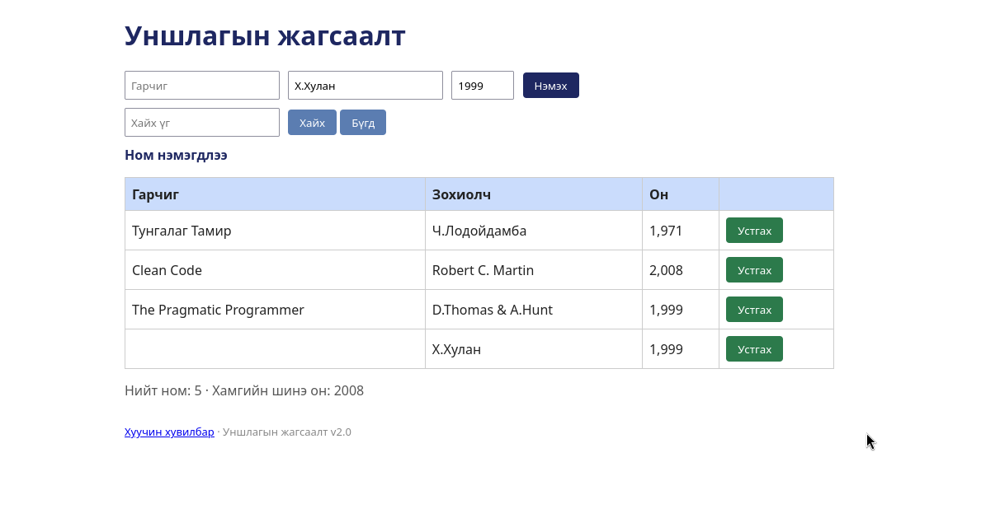

# BUG-01: Гурван талбар хоосон байхад ном нэмэгдэж, "Ном нэмэгдлээ" мессеж гарна

Орчин: Уншлагын жагсаалт v2.0, Google Chrome, Ubuntu Linux, 2026-10-18

Урьдчилсан нөхцөл: node app.js-ийг шинээр асаасан (анхны 3 ном)

## Дахин гаргах алхам

1. Браузераар http://localhost:3000 нээнэ.
2. Гарчиг, Зохиолч, Он талбаруудыг хоосон орхино.
3. "Нэмэх" товчийг дарна.
4. Хүснэгт болон хуудасны мессеж хэсгийг харна.

Хүлээгдэж байсан: «Ном нэмэхэд Гарчиг, Зохиолч, Он гурван талбар бүгд заавал бөглөгдсөн байх ёстой; дутуу бол ном нэмэгдэхгүй, ойлгомжтой алдааны мессеж харагдана.»

Бодит үр дүн: "Ном нэмэгдлээ" мессеж гарч, хүснэгтэд хоосон гарчиг, хоосон зохиолчтой, оныг 0 гэж харуулсан мөр нэмэгдэв. Гарчиг эсвэл Зохиолч эсвэл Он ганцаар хоосон байх үед ч ном нэмэгдэнэ .

Ноцтой байдал: Major — шалгалтгүйгээр хоосон бичлэг хадгалагдаж, өгөгдлийн бүрэн бүтэн байдал алдагдана.

Хавсралт: 

Олдсон аялал: Couch Potato (хоосон оролт)
