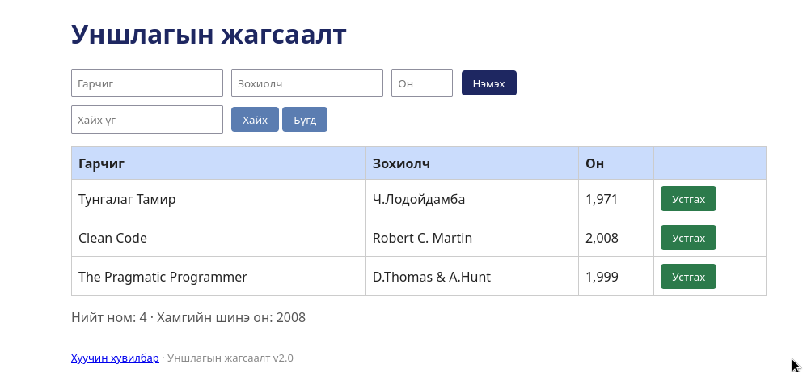

# BUG-04: "Нийт ном" тоолуур хүснэгтэд буй номын тооноос 1-ээр их гарна

Орчин: Уншлагын жагсаалт v2.0, Google Chrome , Ubuntu Linux, 2026-10-18

Урьдчилсан нөхцөл: node app.js-ийг шинээр асаасан (анхны 3 ном)

## Дахин гаргах алхам

1. Браузераар http://localhost:3000 нээнэ.
2. Хүснэгтэд 3 ном байгааг тоолно.
3. Хүснэгтийн доор байгаа "Нийт ном: ..." мөрийг харна.
4. Терминалд `curl -i localhost:3000/api/stats` ажиллуулж хариуг харна.

Хүлээгдэж байсан: «"Нийт ном" тоолуур хүснэгтэд буй номын тоотой тэнцүү.»

Бодит үр дүн: Хүснэгтэд 3 ном байхад "Нийт ном: 4" гэж харагдана. API нь `{"total":4,...}` гэж буцаана.

Ноцтой байдал: Major — хэрэглэгчид худал тоон мэдээлэл харуулдаг.

Хавсралт: 

Олдсон аялал: Fed-Ex (өгөгдлийн зам), Saboteur (API)
