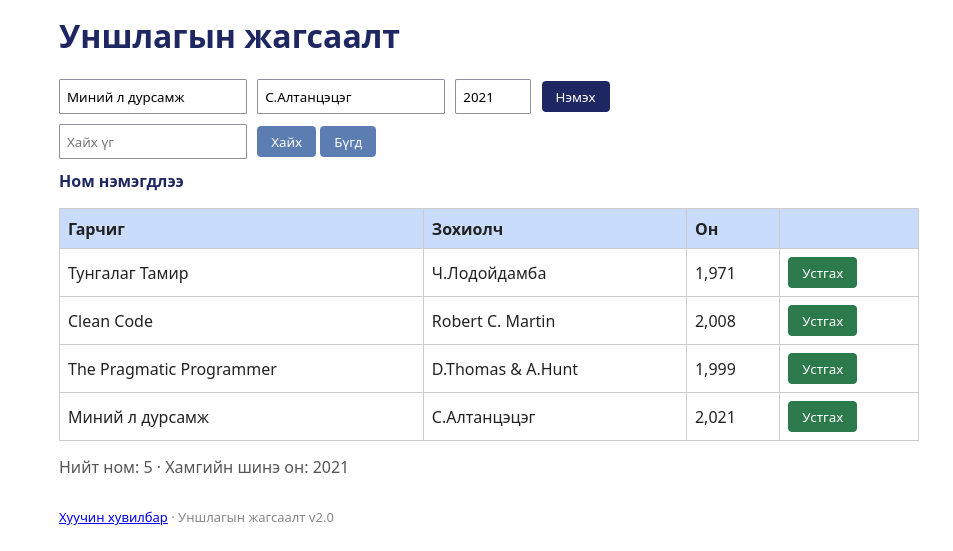

# BUG-05: Хүснэгтэд он мянгатын таслалтай (1,971) харагдана

Орчин: Уншлагын жагсаалт v2.0, Google Chrome , Ubuntu Linux, 2026-10-18

Урьдчилсан нөхцөл: node app.js-ийг шинээр асаасан (анхны 3 ном)

## Дахин гаргах алхам

1. Браузераар http://localhost:3000 нээнэ.
2. Хүснэгтийн "Он" баганыг харна.

Хүлээгдэж байсан: «Он ... хүснэгтэд энгийн тоогоор (жишээ нь 1999) харагдана.»

Бодит үр дүн: Он "1,971", "2,008", "1,999" гэж таслалтай харагдана.

Ноцтой байдал: Minor — мэдээлэл ойлгогдохоос гадна оны форматыг буруу харуулдаг.

Хавсралт: 

Олдсон аялал: Supermodel (GUI)
