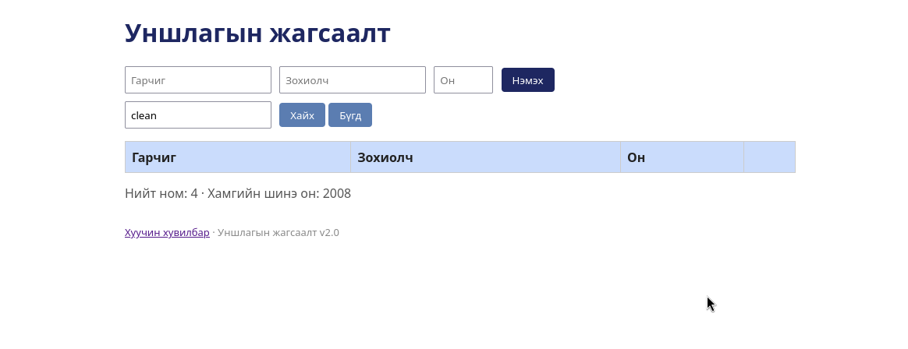

# BUG-07: Хайлт том/жижиг үсгийг ялгаж, үр дүн өөр гарна

Орчин: Уншлагын жагсаалт v2.0, Google Chrome, Ubuntu Linux, 2026-10-18

Урьдчилсан нөхцөл: node app.js-ийг шинээр асаасан (анхны 3 ном)

## Дахин гаргах алхам

1. Браузераар http://localhost:3000 нээнэ.
2. "Хайх үг" талбарт `Clean` гэж бичээд "Хайх" дарна. Үр дүнг тэмдэглэнэ.
3. Талбарыг `clean` болгож (жижиг үсгээр) дахин "Хайх" дарна.

Хүлээгдэж байсан: «Хайлт гарчиг болон зохиолчоос хайх ба том/жижиг үсгийг ЯЛГАХГҮЙ.»

Бодит үр дүн: `Clean` үед "Clean Code" гарна, `clean` үед үр дүн гарахгүй.

Ноцтой байдал: Major — хайлтын гол үүрэг алдагдаж, хэрэглэгч байгаа номыг олохгүй.

Хавсралт: 

Олдсон аялал: Couch Potato (хайлт)
