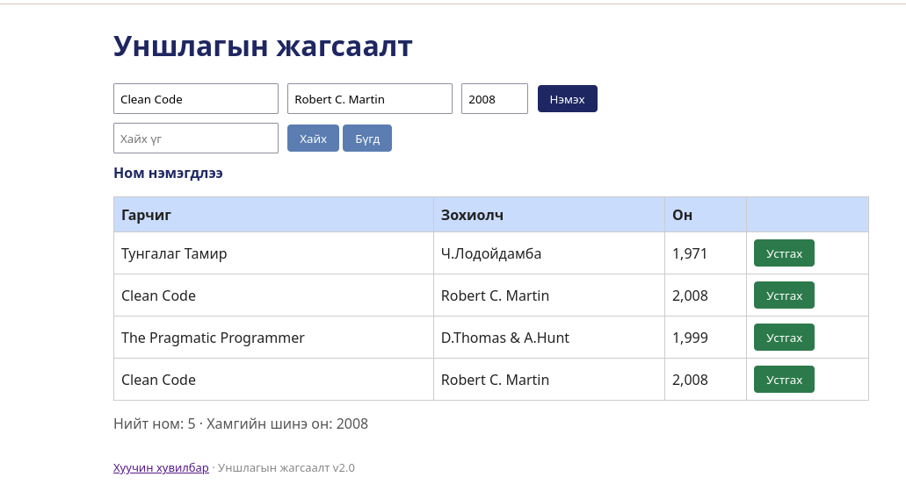

# BUG-08: Ижил гарчиг, зохиолч, онтой ном давхардаж нэмэгдэнэ

Орчин: Уншлагын жагсаалт v2.0, Google Chrome, Ubuntu Linux, 2026-10-18

Урьдчилсан нөхцөл: node app.js-ийг шинээр асаасан (анхны 3 ном)

## Дахин гаргах алхам

1. Браузераар http://localhost:3000 нээнэ.
2. Гарчиг: `Clean Code`, Зохиолч: `Robert C. Martin`, Он: `2008` гэж бичээд "Нэмэх" дарна.
3. Хүснэгтийг харна.

Хүлээгдэж байсан: «Ижил гарчиг, зохиолчтой ном давхардуулж нэмэгдэхгүй.»

Бодит үр дүн: Хүснэгтэд "Clean Code" хоёр мөр болж харагдана.

Ноцтой байдал: Major — өгөгдөл давхардана.

Хавсралт: 

Олдсон аялал: Fed-Ex (өгөгдлийн зам)
