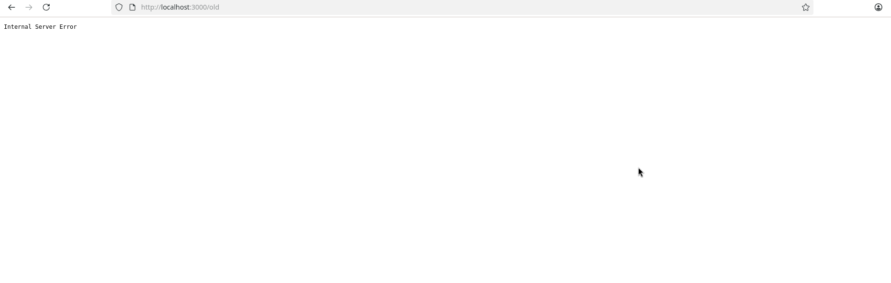

# BUG-10: "Хуучин хувилбар" линк дээр дарахад "Internal Server Error" (HTTP 500) гарна

Орчин: Уншлагын жагсаалт v2.0, Google Chrome , Ubuntu Linux, 2026-10-18

Урьдчилсан нөхцөл: node app.js-ийг шинээр асаасан (анхны 3 ном)

## Дахин гаргах алхам

1. Браузераар http://localhost:3000 нээнэ.
2. Хуудасны доод талын "Хуучин хувилбар" линк дээр дарна.
3. Эсвэл терминалд: `curl -i localhost:3000/old`

Хүлээгдэж байсан: «Бүх хуудас, линк ажиллана.»

Бодит үр дүн: Хуудас "Internal Server Error" гэж гарч, curl -i нь `HTTP/1.1 500 Internal Server Error` мөр буцаана.

Ноцтой байдал: Major — хуудсан дээрх линк ажиллахгүй.

Хавсралт:  

Олдсон аялал: Saboteur (API/хуудас)
