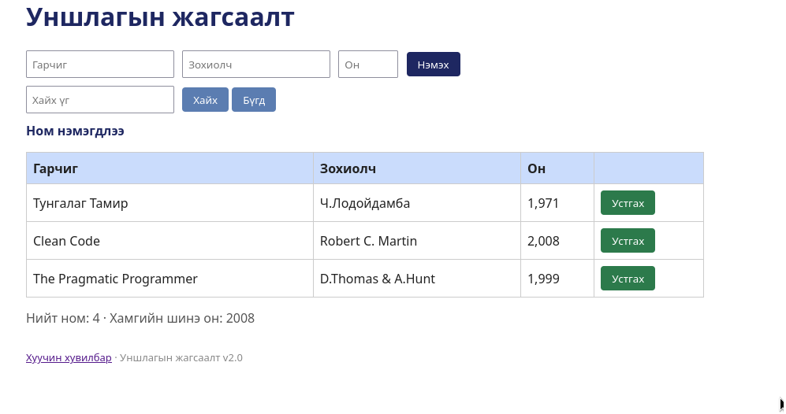

# BUG-11: "Устгах" товч улаан биш ногоон өнгөтэй

Орчин: Уншлагын жагсаалт v2.0, Google Chrome, Ubuntu Linux, 2026-10-18

Урьдчилсан нөхцөл: node app.js-ийг шинээр асаасан (анхны 3 ном)

## Дахин гаргах алхам

1. Браузераар http://localhost:3000 нээнэ.
2. Хүснэгтийн мөр бүрийн "Устгах" товчийн өнгийг харна.

Хүлээгдэж байсан: «Аюултай үйлдлийн товч (Устгах) улаан өнгөтэй.»

Бодит үр дүн: "Устгах" товч ногоон өнгөтэй.

Ноцтой байдал: Cosmetic — ажиллагаанд нөлөөгүй, харин аюултай үйлдлийн өнгөний нийтлэг дүрмийг зөрчинө.

Хавсралт: 

Олдсон аялал: Supermodel (GUI)
