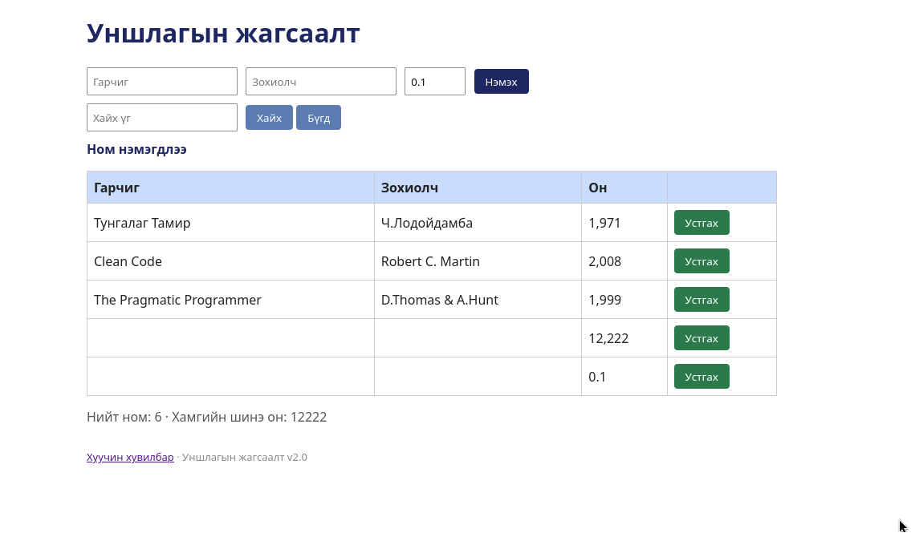

# BUG-12: Оны хязгаар болон бүхэл тооны шалгалт ажиллахгүй (12222, 0.1 зөвшөөрөгдөнө)

Орчин: Уншлагын жагсаалт v2.0, Google Chrome <ХУВИЛБАР>, Ubuntu Linux, 2026-10-18

Урьдчилсан нөхцөл: node app.js-ийг шинээр асаасан (анхны 3 ном)

## Дахин гаргах алхам

1. Браузераар http://localhost:3000 нээнэ.
2.  Он: `12222` гэж бичээд "Нэмэх" дарна.
3. Дахин  Он: `0.1` гэж бичээд "Нэмэх" дарна.
4. Хүснэгтийг харна.

Хүлээгдэж байсан: «Он нь 1000-2100 хоорондох бүхэл тоо.»

Бодит үр дүн: Он "12,222" ба "0.1" гэж хүснэгтэд нэмэгдэнэ. Алдааны мессеж гарахгүй.

Ноцтой байдал: Major — оны шалгалтгүй буруу өгөгдөл орно.

Хавсралт: 

Олдсон аялал: Couch Potato (хязгаарын оролт)
