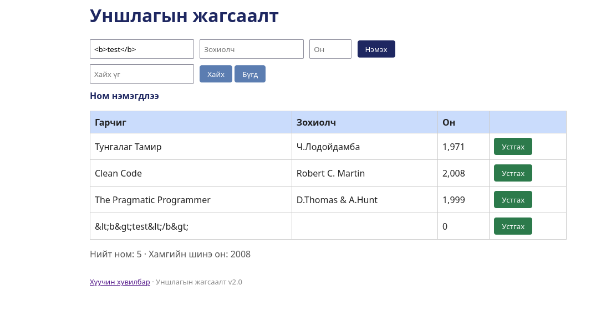

# BUG-13: Гарчигт оруулсан HTML тэмдэгт хүснэгтэд кодлогдсон хэлбэрээр (&lt;b&gt;) харагдана

Орчин: Уншлагын жагсаалт v2.0, Google Chrome, Ubuntu Linux, 2026-10-18

Урьдчилсан нөхцөл: node app.js-ийг шинээр асаасан (анхны 3 ном)

## Дахин гаргах алхам

1. Браузераар http://localhost:3000 нээнэ.
2. Гарчиг: `<b>test</b>` гэж бичээд "Нэмэх" дарна.
3. Хүснэгтийн шинэ мөрийг харна.
4. Терминалд `curl -i localhost:3000/api/books` ажиллуулж хариуг харна.

Хүлээгдэж байсан: «Хэрэглэгчийн оруулсан гарчиг хүснэгтэд оруулсан хэвээр нь (<b>test</b>) харагдана.»

Бодит үр дүн: Хүснэгтэд `&lt;b&gt;test&lt;/b&gt;` гэж харагдана. API-ийн хариунд гарчиг кодлогдсон хэлбэрээр хадгалагдсан байна.

Ноцтой байдал: Minor — өгөгдөл өөрчлөгдөж харагддаг, аюулгүй байдлын асуудал үүсгэхгүй.

Хавсралт:  

Олдсон аялал: Saboteur (тусгай тэмдэгт)
