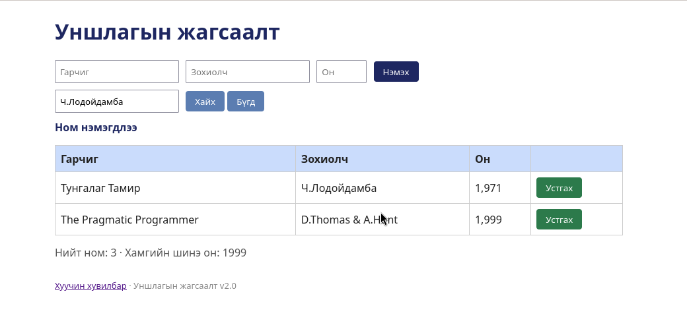

# BUG-14: Устгах болон хоосон оролтоор нэмэх үйлдлийн дараа "Ном нэмэгдлээ" гэсэн буруу мессеж гарна

Орчин: Уншлагын жагсаалт v2.0, Google Chrome, Ubuntu Linux, 2026-10-18

Урьдчилсан нөхцөл: node app.js-ийг шинээр асаасан (анхны 3 ном)

## Дахин гаргах алхам

1. Браузераар http://localhost:3000 нээнэ.
2. Эхний мөрийн "Устгах" товчийг дарна. Мессеж хэсгийг харна.
3. Аппыг шинээр асаасны дараа гурван талбарыг хоосон орхиод "Нэмэх" дарна. Мессеж хэсгийг харна.

Хүлээгдэж байсан: «Үйлдэл бүрийн дараах мессеж тухайн үйлдэлдээ тохирно.» Устгасны дараа устгасан тухай мессеж, хоосон оролтод алдааны мессеж.

Бодит үр дүн: Хоёр тохиолдолд "Ном нэмэгдлээ" гэж гарна.

Ноцтой байдал: Minor — функцэд нөлөөгүй ч хэрэглэгчийг төөрөлдүүлнэ.

Хавсралт: 

Олдсон аялал: Supermodel (мессеж)
